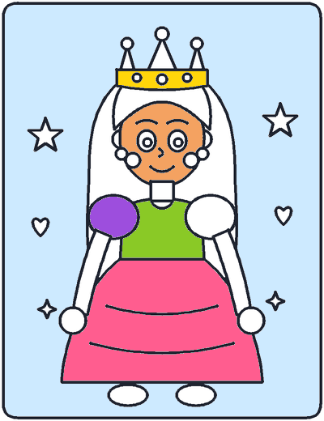

# 🎨 Colorea y Pinta

App web para que los niños coloreen dibujos **online**, inspirada en la experiencia de
[colorear-online.com/colorear-princesas](https://colorear-online.com/colorear-princesas/princesas/?nombre=princess-01):
se elige una lámina, se toca el dibujo para rellenar zonas con color, se dibuja a mano alzada
y el resultado se descarga o se imprime.

Además de las 9 láminas incluidas, **puedes subir tus propias imágenes PNG o JPG y colorearlas**
con las mismas herramientas: el bote de pintura rellena por píxeles respetando las líneas negras.

Todo el contenido es **original** y **funciona sin conexión**: los dibujos son SVG creados para
este proyecto (no se ha copiado ningún archivo del sitio original) y las láminas van incrustadas
en el código, así que no hace falta servidor ni red.



## Cómo abrirla

1. Abre `index.html` con doble clic (Chrome, Edge o Firefox).
2. Admite el mismo parámetro que el sitio original: `index.html?nombre=princess-01` abre esa lámina,
   y `index.html?nombre=subido:sxxxxx` abre una de tus imágenes subidas.

Si prefieres servirla por HTTP (recomendado para que el guardado funcione siempre igual):

```powershell
python herramientas/servidor.py      # abre http://localhost:8000
```

## Qué incluye

**Galería**

- 9 láminas originales repartidas en 3 categorías: *Princesas*, *Reino mágico* y *Amigos*.
- Zona para **subir tus dibujos**: botón, arrastrar y soltar o pegar con Ctrl+V. Cada imagen
  subida aparece en la categoría **Mis dibujos**.
- Filtros por categoría, miniatura de cada dibujo, progreso guardado y botón para imprimir
  cualquier lámina (en blanco, o tu imagen tal cual).

**Taller de pintado**

- 🪣 **Relleno**: un toque pinta la zona elegida. Arrastrando se pintan varias zonas seguidas.
- 🖌️ **Pincel**: dibujo a mano alzada con grosor regulable de 2 a 40.
- 🧽 **Borrador**: quita el trazo que toques; en las láminas SVG deja la zona blanca y en tus
  imágenes recupera los píxeles originales.
- Paleta de 24 colores, selector de color libre y color blanco para "despintar".
- ↶ **Deshacer** y ↷ **Rehacer** sin límite práctico (Ctrl+Z / Ctrl+Y).
- 🧼 **Borrar todo**, 🎉 **¡Terminé!**, ⬇️ **Descargar PNG**, 🖼️ **Descargar SVG** (solo láminas
  incluidas) y 🖨️ **Imprimir**.
- Contador de progreso, felicitación al completar una lámina y **guardado automático**: puedes
  cerrar y seguir otro día.
- Atajos de teclado: `R` relleno, `P` pincel, `B` borrador, `Esc` volver a la galería.
- Diseño adaptable a móvil y tableta, con soporte táctil.

## Tus propios dibujos (PNG o JPG)

1. En la galería, pulsa **⬆️ Subir mi dibujo**, arrastra la imagen a la zona punteada o pégala
   con **Ctrl+V**.
2. La imagen se normaliza (máximo 1600 px de lado, fondo blanco si tenía transparencia) y se abre
   directamente en el taller.
3. Pinta con el bote: el relleno se expande por los píxeles del mismo color y **se detiene en las
   líneas negras**. Si tu imagen tiene sombras o degradados, ajusta la **tolerancia**; si quieres
   poder pintar encima de las líneas, desmarca **Respetar las líneas negras**.
4. Descarga el resultado en PNG o imprímelo.

Detalles útiles:

- Tus imágenes se guardan en el navegador (IndexedDB) y lo pintado en `localStorage`, así que
  siguen ahí al volver. Cada imagen tiene su botón 🗑️ para quitarla.
- Formatos admitidos: PNG, JPG y WebP, hasta 12 MB por archivo (se pueden subir varias a la vez).
- Si el navegador no permite guardar (algunos casos con `file://`), la app avisa y sigue
  funcionando durante la sesión.

## Estructura del proyecto

```
index.html                  Interfaz (galería + taller)
css/estilos.css             Estilos, paleta y reglas de impresión
js/nucleo.js                Lógica pura: zonas SVG, bote por píxeles, historial, exportación
js/app.js                   Interfaz: herramientas, subida de imágenes, descargas, impresión
js/dibujos.js               GENERADO: láminas SVG incrustadas
dibujos/*.svg               Láminas originales (fuente de verdad)
dibujos/manifest.json       Título y categoría de cada lámina
docs/ejemplo-colorear-png.png  Ejemplo de una lámina rasterizada y coloreada
herramientas/empaquetar.py  Regenera js/dibujos.js a partir de dibujos/
herramientas/rasterizar.py  Convierte las láminas a PNG para revisarlas sin navegador
herramientas/pruebas.js     Pruebas de la lógica (Node): 98 comprobaciones
herramientas/servidor.py    Servidor local opcional en http://localhost:8000
herramientas/_contacto.png  Vista previa de todas las láminas
```

## Añadir tus propios dibujos al proyecto

1. Crea un SVG en `dibujos/` con las mismas convenciones:

   - `viewBox="0 0 400 520"`.
   - Cada forma que se pueda pintar lleva `class="rg"` (contorno cerrado). Las líneas decorativas
     (bocas, rayas, ondas) llevan `class="ln"` y no se rellenan.
   - El orden del documento decide qué queda delante; las formas de encima tapan las de debajo.

2. Añade su título y categoría en `dibujos/manifest.json`.
3. Ejecuta:

   ```powershell
   python herramientas/empaquetar.py     # regenera js/dibujos.js
   python herramientas/rasterizar.py     # (opcional) PNG de control en herramientas/_png
   node herramientas/pruebas.js          # comprueba que todo sigue cuadrando
   ```

## Notas técnicas

- **Sin dependencias**: JavaScript clásico (ES5+), sin build ni `npm install`.
- **Dos modos de pintado**:
  - *Láminas SVG*: cada forma numerada (`rg-0`, `rg-1`, …) guarda su color; el historial son
    instantáneas de ese mapa.
  - *Imágenes subidas*: el estado es una **lista de operaciones** (relleno con tolerancia, trazo,
    borrado) que se reproducen sobre la imagen original. Deshacer y rehacer reconstruyen el lienzo
    desde cero, y el historial ocupa muy poco.
- **Bote de pintura**: relleno por inundación por franjas (*scanline flood fill*) implementado
  sobre `Uint8ClampedArray`, sin recursión. Compara colores con tolerancia, trata los píxeles
  transparentes como blancos y nunca pinta sobre píxeles más oscuros que el umbral de línea (110).
- **Exportación**: las láminas SVG se reconstruyen con los colores en línea y los trazos como
  `<path>`; en ambos modos el PNG final se obtiene con `canvas.toBlob` a resolución nativa (3× en
  las láminas incluidas).
- **Guardado**: `localStorage` con la clave `colorear:pintura:<nombre>` para lo pintado e
  IndexedDB (`colorear-pintura` → `imagenes`) para tus imágenes.
- **Impresión**: se hace en un `iframe` oculto con el SVG o la imagen y sus estilos, sin ventanas
  emergentes.

## Derechos

Los dibujos y el código de este proyecto son originales y puedes usarlos libremente en casa o en
clase. Las imágenes que subas son tuyas: se quedan en tu navegador y nunca se envían a ningún
servidor. La inspiración es la mecánica de juego de colorear-online.com; **no** se ha copiado ni
enlazado su arte, sus textos ni su código, que siguen siendo de sus autores.
